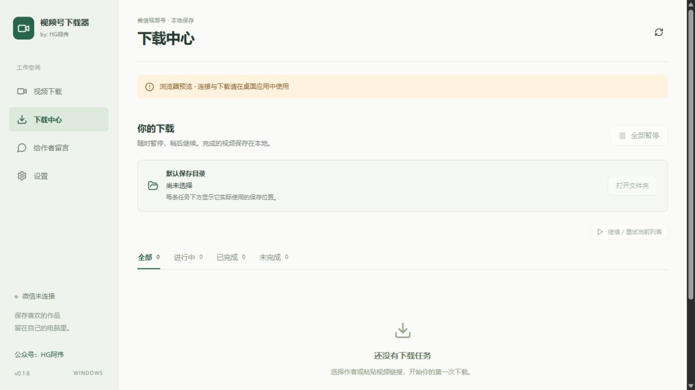

  

<h1 align="center">微信视频号下载器</h1>

把喜欢的视频，留在自己的电脑里。

Windows 10 / 11 · 关注作者 · 批量下载 · 本地保存 · by HG阿伟

  <a href="https://www.hgawei.cn/software"><strong>HG阿伟官网 · 软件资源库</strong></a>
  · 微信公众号：<strong>HG阿伟</strong>

> **获取软件与更新消息**：微信搜索公众号 **「HG阿伟」** 并关注，也可以访问 [HG阿伟官网资源库](https://www.hgawei.cn/software)。现有视频版安装包入口见下方「下载与安装」。

这是一款 Windows 桌面视频号下载工具。登录电脑微信、连接视频号页面后，可以从「我的关注」选择作者、搜索作者，或粘贴一条视频链接，把需要的作品保存到本地。

想只留几条，就勾选作品下载；想按作者整理，可以使用「下载作者全部作品」，让软件继续获取后续分页，并下载符合筛选条件的作品。进度、暂停、重试和保存位置都能在「下载中心」查看。

**快速入口：[安装与使用教程](docs/USAGE.md) · [常见问题](docs/FAQ.md) · [公众号文章下载器](https://github.com/ghgdzw/wechat-download)**

本文根据 **v0.1.6** 整理，介绍与截图不代表后续所有版本。下载渠道、界面和功能变化以实际安装版本及作者消息为准。

## 界面预览

*v0.1.6 下载中心的浏览器界面预览，处于未连接微信、没有任务的状态；连接和下载需在桌面软件中使用。此图不作为真实下载结果或微信兼容性的证明。*

## 适合用来做什么

- **离线观看**：保存有权下载的作品，方便在电脑上反复观看。
- **按作者整理**：从关注列表或搜索结果进入作者作品列表，集中整理视频。
- **按主题收藏**：结合标题关键词、发布日期筛选，选择需要的内容。

## 主要功能

| 功能 | 说明 |
| --- | --- |
| 我的关注 | 读取当前微信账号关注的作者，支持筛选、刷新和继续加载 |
| 搜索作者 | 输入作者名称，选择对应作者并查看作品 |
| 单链接下载 | 粘贴软件支持的视频号分享链接，解析后下载 |
| 选择作品下载 | 勾选作品，按标题关键词、发布日期筛选 |
| 作者作品批量下载 | 自动继续获取作者作品分页，保存符合条件的可访问作品 |
| 清晰度选择 | 选择「最高可用清晰度」或「默认原始规格」，以视频实际提供的规格为准 |
| 下载中心 | 查看任务和保存位置，暂停、继续或重试未完成任务 |
| 已完成结果跳过 | 完整结果可跳过，文件缺失或未完成时按任务状态恢复处理 |
| 留言与更新 | 软件内查看更新提示、给作者留言并查看回复 |

## 下载与安装

**先关注微信公众号「HG阿伟」**，获取软件使用说明与后续更新消息。

- **官网资源库**：[www.hgawei.cn/software](https://www.hgawei.cn/software)。这是官网软件资源入口，视频版是否单独上架以页面实际内容为准。
- **现有 v0.1.6 安装包**：[下载 Windows x64 安装程序](https://www.hgawei.cn/api/v1/desktop/updates/be1cd0cd-5b77-452c-868c-549b0007d2f7/installer)。该地址对应已有发布记录，不表示后续最新版。
- **公众号文章归档**：如果需要保存公众号图文，可查看 [微信公众号下载器](https://www.hgawei.cn/software/b5cf1519-1161-443a-b2da-393d0b79de0f)。

运行环境为 **Windows 10/11 64 位、已登录的电脑微信和可用网络**。缺少 WebView2 界面组件时，软件会按需准备；运行软件不需要安装 Python、Node.js、Rust 或 Go。

安装版按安装向导操作。便携版请完整解压后再运行，主程序和配套后台程序需要保留在同一个完整目录中。本仓库提供介绍、教程和图片。

## 第一次使用

1. 打开下载器并登录电脑微信，等待软件完成在线启动检查。
2. 点击「连接微信」，首次使用按 Windows 提示确认，再打开微信视频号页面。
3. 在「我的关注」选择作者，或使用「搜索作者」「粘贴链接」查找作品。
4. 确认保存目录和清晰度，选择作品后点击「下载选中」。
5. 需要批量整理时，选择「下载作者全部作品」，核对筛选条件后开始。
6. 在「下载中心」查看进度，点击「打开保存目录」或「定位文件」查看结果。

**使用时保持电脑微信及视频号页面打开。** 连接异常时，按软件提示重新连接并重新打开视频号页面。

详细步骤见 [安装与使用教程](docs/USAGE.md)。

## 保存位置与任务恢复

首页与设置里可以更改默认保存目录。下载中心会显示每条任务实际使用的保存位置；更改默认目录不会把旧任务或已下载文件自动迁移过去。

可以在下载中心暂停、继续或重试任务。重启软件后，按任务状态重新连接并继续；已完成任务需要文件仍然完整，才可按已有结果跳过。

## 使用说明

「作者全部作品」表示继续获取本次微信接口可访问的作品，不保证包含所有历史、已删除或不可访问的内容。当前列表数量也不等于作者全部作品数量。微信版本、页面连接状态和接口限制可能影响使用，遇到异常按提示处理。

请仅下载有权使用的内容；转载、传播或二次使用前取得相应授权。

## 反馈与更新

微信搜索公众号 **「HG阿伟」** 并关注，获取软件更新与使用消息。

问题可通过本仓库 [Issues](https://github.com/ghgdzw/wechat-video-download/issues) 或软件中的「给作者留言」反馈。建议说明软件版本、Windows 与微信版本、操作步骤和错误提示；截图先隐藏私人信息，不要提交微信凭证、Cookie、本机数据库或私人视频。

**[访问 HG阿伟官网](https://www.hgawei.cn/software)** · **[查看公众号文章下载器](https://github.com/ghgdzw/wechat-download)**
